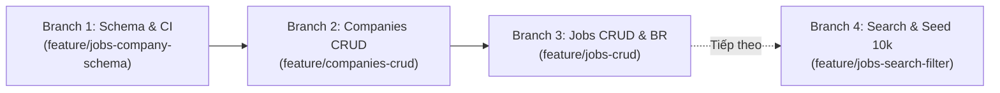
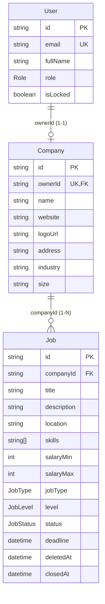

# Báo Cáo Kỹ Thuật: 3 Tính Năng Đã Triển Khai (Author: Nam)

> **Dự án:** Recruitment Management System 
> **Thành viên phụ trách:** Nam (Company, Jobs, Search, Admin)  
> **Các nhánh hoàn thành:** `feature/jobs-company-schema`, `feature/companies-crud`, `feature/jobs-crud`  
> **Trạng thái:** Đã tích hợp, kiểm thử 100% pass, sẵn sàng cho giai đoạn Search & Admin  

---

## 1. Tổng Quan Tiến Độ



| STT | Nhánh | Use Case | Business Rules | Trạng thái Code & Test |
|---|---|---|---|---|
| **1** | `feature/jobs-company-schema` | Nền tảng dữ liệu cho UC05, 06, 13, 14, 15 | Ràng buộc quan hệ 1-1, Soft Delete | Schema valid, Migration SQL tạo thành công, CI Pipeline thiết lập |
| **2** | `feature/companies-crud` | UC13 (Quản lý công ty) | Quan hệ 1-1 giữa Recruiter và Company | 5 API endpoints, 11/11 tests passed |
| **3** | `feature/jobs-crud` | UC14 (Tạo, sửa, xóa tin), UC15 (Đóng tin) | **BR-04**, **BR-05**, **BR-08**, Quyền sở hữu | 7 API endpoints, 13/13 tests passed |

---

## 2. Chi Tiết Từng Tính Năng

### Tính năng 1: Schema Cơ Sở Dữ Liệu & Pipeline CI (`feature/jobs-company-schema`)

#### 2.1 Thiết kế Schema Prisma
File mã nguồn: [`backend/prisma/schema.prisma`](file:///home/nam/Desktop/Recruitment-Management-System/backend/prisma/schema.prisma)



- **Enums mới:**
  - `JobStatus`: `DRAFT` $\rightarrow$ `PENDING` $\rightarrow$ `APPROVED` $\rightarrow$ `CLOSED` / `REJECTED`.
  - `JobType`: `FULL_TIME`, `PART_TIME`, `INTERNSHIP`, `CONTRACT`, `REMOTE`.
  - `JobLevel`: `INTERN`, `FRESHER`, `JUNIOR`, `MIDDLE`, `SENIOR`, `LEAD`, `MANAGER`.
- **Ràng buộc toàn vẹn & Tối ưu hóa:**
  - `companies.ownerId`: Khóa ngoại `UNIQUE` trỏ về `users.id`, thiết lập quan hệ 1-1 bất biến.
  - `jobs.skills`: Đánh chỉ mục **GIN Index** (`USING GIN ("skills")`) hỗ trợ tìm kiếm mảng kỹ năng siêu tốc bằng toán tử `hasSome` của PostgreSQL.
  - Chỉ mục tổ hợp: `@@index([status, deletedAt, createdAt])` tối ưu hóa cho trang chủ duyệt tin tuyển dụng.
  - Khóa ngoại `onDelete: Restrict`: Ngăn chặn việc vô tình xóa User khi đang sở hữu Công ty, hoặc xóa Công ty khi vẫn còn Tin tuyển dụng.

#### 2.2 Pipeline CI tự động (`.github/workflows/ci.yml`)
File mã nguồn: [`.github/workflows/ci.yml`](file:///home/nam/Desktop/Recruitment-Management-System/.github/workflows/ci.yml)
- Tự động kích hoạt khi có sự kiện `push` hoặc mở `pull_request` vào 2 nhánh hạt nhân `main` và `develop`.
- Chạy song song 2 Job:
  - **`backend-ci`:** `npm ci` $\rightarrow$ `npx prisma generate` $\rightarrow$ `npm run lint` (ESLint) $\rightarrow$ `npm test` (Unit Test) $\rightarrow$ `npm run build` (Biên dịch NestJS).
  - **`frontend-ci`:** `npm ci` $\rightarrow$ `npm run lint` $\rightarrow$ `npm run build` (`tsc -b && vite build`).

---

### Tính năng 2: Module Quản Lý Công Ty (`feature/companies-crud` - UC13)

File thư mục: [`backend/src/companies/`](file:///home/nam/Desktop/Recruitment-Management-System/backend/src/companies)

#### 2.1 Các API Endpoints
| Phương thức | Tuyến đường (Route) | Mục đích | Quyền hạn dự kiến |
|---|---|---|---|
| `POST` | `/api/companies` | Tạo mới công ty | Recruiter (chưa có công ty) |
| `GET` | `/api/companies` | Danh sách công ty (phân trang, tìm kiếm) | Public (Guest, Candidate) |
| `GET` | `/api/companies/my-company` | Xem công ty của Recruiter đang đăng nhập | Recruiter |
| `GET` | `/api/companies/:id` | Xem chi tiết công ty & 10 việc làm mới nhất | Public |
| `PATCH` | `/api/companies/:id` | Cập nhật thông tin công ty | Chủ sở hữu công ty / Admin |

#### 2.2 Nghiệp vụ bảo vệ (Business Logic Guarding)
- **Kiểm soát vai trò:** Chỉ cho phép tài khoản có `role: RECRUITER` (hoặc `ADMIN`) tạo hồ sơ công ty; tài khoản `CANDIDATE` bị từ chối bằng lỗi `403 Forbidden`.
- **Ràng buộc 1 Recruiter = 1 Công ty:** Nếu Recruiter đã có công ty trong DB, lệnh tạo tiếp theo sẽ bị chặn lại với mã lỗi **`409 Conflict: Mỗi nhà tuyển dụng chỉ được sở hữu một công ty`**.
- **Tính toán số liệu động:** Khi gọi danh sách công ty `GET /api/companies`, hệ thống đính kèm `_count.jobs` đếm số lượng tin đang mở (`APPROVED` và `deletedAt: null`).

---

### Tính năng 3: Module Quản Lý Tin Tuyển Dụng (`feature/jobs-crud` - UC14, UC15)

File thư mục: [`backend/src/jobs/`](file:///home/nam/Desktop/Recruitment-Management-System/backend/src/jobs)

#### 3.1 Các API Endpoints
| Phương thức | Tuyến đường (Route) | Mục đích | Business Rule áp dụng |
|---|---|---|---|
| `POST` | `/api/jobs` | Đăng tin tuyển dụng mới | **BR-04** (Bắt buộc có công ty) |
| `GET` | `/api/jobs` | Danh sách việc làm công khai | Lọc chỉ tin `APPROVED`, `deletedAt: null` |
| `GET` | `/api/jobs/my-jobs` | Danh sách tin thuộc công ty của Recruiter | Xem toàn bộ các trạng thái (DRAFT, PENDING,...) |
| `GET` | `/api/jobs/:id` | Xem chi tiết tin tuyển dụng (UC06) | Trả về kèm thông tin công ty liên kết |
| `PATCH` | `/api/jobs/:id` | Cập nhật tin tuyển dụng | **BR-08** (Kiểm tra sửa nội dung quan trọng) |
| `PATCH` | `/api/jobs/:id/close`| Đóng tin tuyển dụng (UC15) | Cập nhật `status = CLOSED`, `closedAt` |
| `DELETE` | `/api/jobs/:id` | Xóa tin tuyển dụng | **BR-05** (Xóa mềm - Soft Delete) |

#### 3.2 Hiện thực các Quy Tắc Nghiệp Vụ Cốt Lõi (Core Business Rules)

1. **Quy tắc BR-04 (Bắt buộc có công ty trước khi đăng tin):**
   ```typescript
   const company = await this.prisma.company.findUnique({
     where: { ownerId: dto.recruiterId },
   });
   if (!company) {
     throw new BadRequestException(
       'Nhà tuyển dụng phải tạo thông tin công ty trước khi đăng tin tuyển dụng (BR-04)',
     );
   }
   ```
   > [!IMPORTANT]
   > Recruiter không thể đăng tin mồ côi không gắn với công ty. Hệ thống tự động truy xuất `companyId` từ tài khoản Recruiter để bảo toàn tính toàn vẹn dữ liệu.

2. **Quy tắc BR-05 (Xóa mềm - Soft Delete):**
   - Tuyệt đối không gọi `prisma.job.delete()` vì sẽ làm mất liên kết với các đơn ứng tuyển (`Application`) sau này của ứng viên.
   - Khi gọi `DELETE /api/jobs/:id`, hệ thống cập nhật:
     - `deletedAt: new Date()`
     - `status: JobStatus.CLOSED`
   - Tất cả các truy vấn xem danh sách công khai và chi tiết đều gắn thêm điều kiện ngầm `deletedAt: null`.

3. **Quy tắc BR-08 (Sửa tin đã duyệt thì phải chuyển về duyệt lại):**
   - Danh sách trường quan trọng: `title`, `description`, `requirements`, `benefits`, `location`, `skills`, `salaryMin`, `salaryMax`, `jobType`, `level`.
   - Nếu tin tuyển dụng đang ở trạng thái `status: APPROVED` mà Recruiter cập nhật bất kỳ trường nào trong danh sách trên:
     ```typescript
     if (job.status === JobStatus.APPROVED && isEditingImportant) {
       nextStatus = JobStatus.PENDING; // Tự động hạ trạng thái
       approvedAt = null;              // Xóa mốc thời gian duyệt cũ
     }
     ```
   - Đảm bảo nhà tuyển dụng không thể lợi dụng việc tin đã được duyệt để tự ý đổi nội dung thành việc làm rác hoặc lừa đảo.

4. **Bảo vệ quyền sở hữu (Ownership Protection):**
   - Ở các thao tác `update`, `close`, `remove`, hệ thống luôn đối soát `job.company.ownerId === recruiterId`.
   - Bất kỳ hành vi can thiệp trái phép vào tin tuyển dụng của công ty khác đều bị chặn đứng với mã lỗi **`403 Forbidden`**.

---

## 3. Tổng Hợp Kết Quả Kiểm Thử (Test Verification)

Toàn bộ mã nguồn đã được xác thực qua bộ công cụ chất lượng code chuẩn của dự án:

```text
PASS src/jobs/jobs.service.spec.ts (13 tests)
PASS src/companies/companies.service.spec.ts (11 tests)
PASS src/users/users.service.spec.ts (3 tests)
PASS src/app.controller.spec.ts (2 tests)

Test Suites: 4 passed, 4 total
Tests:       29 passed, 29 total
Snapshots:   0 total
Time:        3.368 s
```

- **ESLint:** 0 errors, 0 warnings (Đã xử lý triệt để các lỗi `@typescript-eslint/no-unsafe-member-access` trong unit test mock).
- **NestJS Build:** `nest build` thành công, không phát sinh lỗi biên dịch TypeScript.

---

## 4. Kế Hoạch Tiếp Theo 

Các đầu việc tiếp theo theo tài liệu phân công:

1. **Nhánh `feature/jobs-search-filter` (UC05, UC06):**
   - Nâng cấp endpoint `GET /api/jobs` hỗ trợ tìm kiếm nâng cao đa tiêu chí: `skills` (GIN array matching), khoảng lương `salaryMin/Max`, `location`, `jobType`, `level`, sắp xếp `sort`.
   - Viết kịch bản seed tự động **~10.000 tin tuyển dụng** mẫu và đo kiểm thời gian phản hồi API bảo đảm dưới 500 ms.
2. **Nhánh `feature/admin-jobs-approval` (UC23):**
   - Các API dành cho Admin duyệt tin (`POST /api/admin/jobs/:id/approve`) hoặc từ chối tin kèm lý do (`POST /api/admin/jobs/:id/reject`).
3. **Nhánh `feature/admin-users-lock` (UC21, UC22):**
   - Quản lý danh sách người dùng và khóa/mở khóa tài khoản (phối hợp gọi hàm thu hồi refresh token của Tiến theo quy tắc BR-06).
